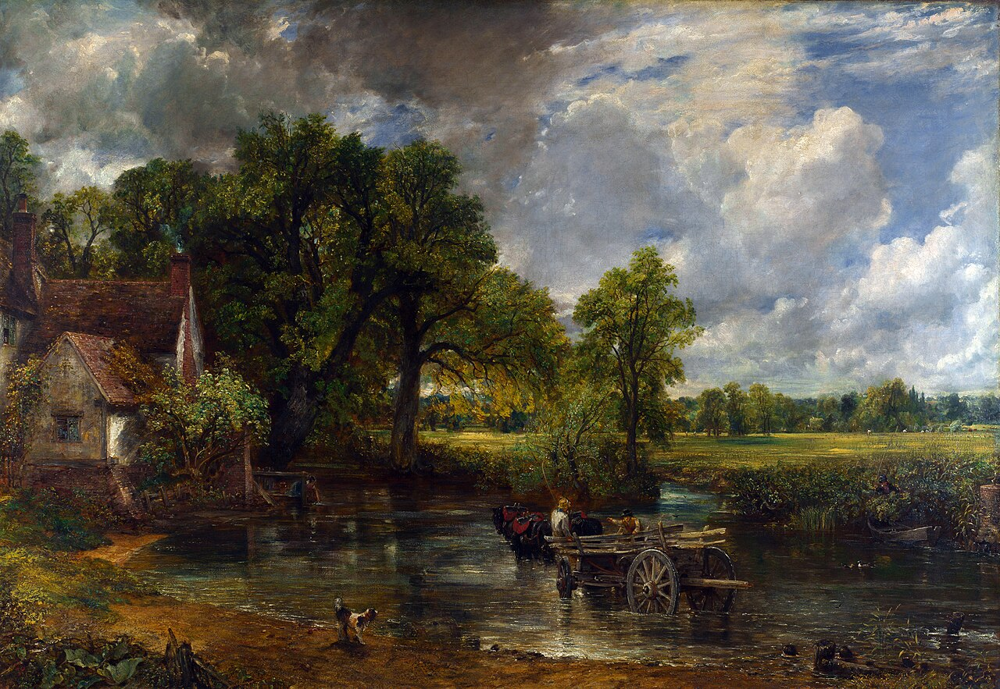

**John Constable** (1776–1837) was an English landscape painter associated with Romanticism. He is especially known for paintings of the Suffolk countryside, including *The Hay Wain*.

Source: [Wikipedia — John Constable](https://en.wikipedia.org/wiki/John_Constable).

*The Hay Wain* (1821), National Gallery, London. [Wikimedia Commons](https://commons.wikimedia.org/wiki/File:John_Constable_-_The_Hay_Wain_%281821%29.jpg), public domain.
