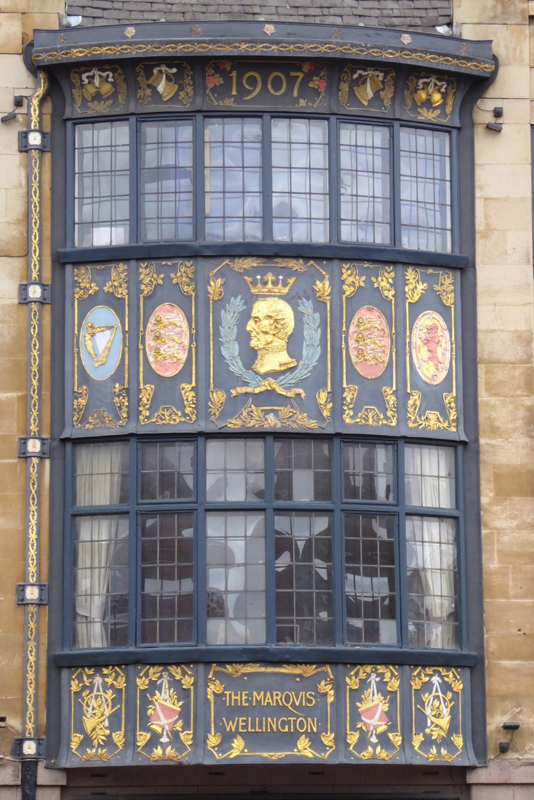

**bow window** (/ˌbəʊ ˈwɪndəʊ/) is a curved bay window that projects beyond a building’s outer wall.

**Bow** here is pronounced /bəʊ/, like the word for a curved shape. In [[Mrs Dalloway]], men watch a passing car from a club’s bow window.

Sources: [Merriam-Webster — bow window](https://www.merriam-webster.com/dictionary/bow%20window); [Wikipedia — Bow window](https://en.wikipedia.org/wiki/Bow_window).

Photo: Philip Halling / Geograph, [Wikimedia Commons](https://commons.wikimedia.org/wiki/File:Decorative_bow_window_facade_-_geograph.org.uk_-_7033136.jpg), [CC BY-SA 2.0](https://creativecommons.org/licenses/by-sa/2.0/).
