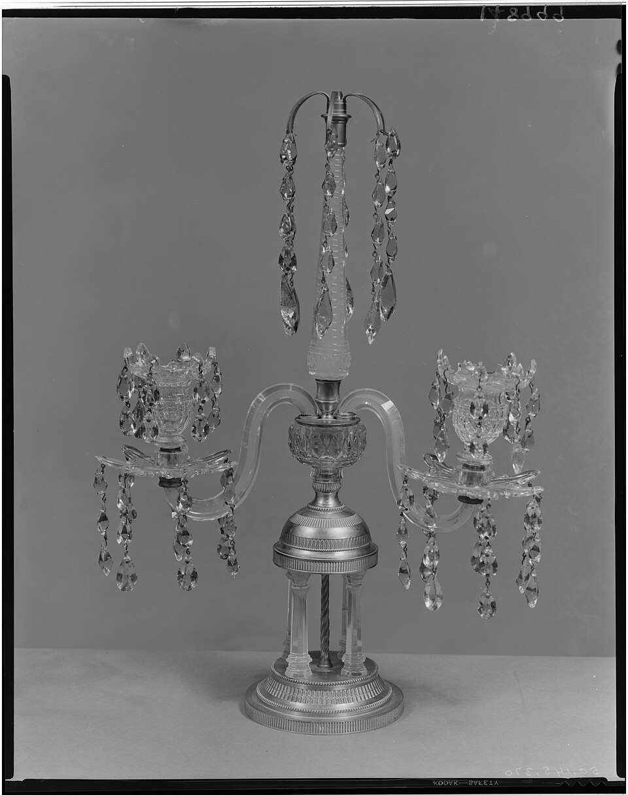

**candelabra** (/ˌkændəˈlɑːbrə/) is a branched stand for several candles.

**Candelabra** can also be the plural of **candelabrum**. [[Mrs Dalloway]] uses the English plural **candelabras** (/ˌkændəˈlɑːbrəz/) in an imagined palace scene.

Source: [Merriam-Webster — candelabra](https://www.merriam-webster.com/dictionary/candelabra).

Image: The Metropolitan Museum of Art, [Wikimedia Commons](https://commons.wikimedia.org/wiki/File:Candelabrum_MET_148999.jpg), [CC0](https://creativecommons.org/publicdomain/zero/1.0/).
