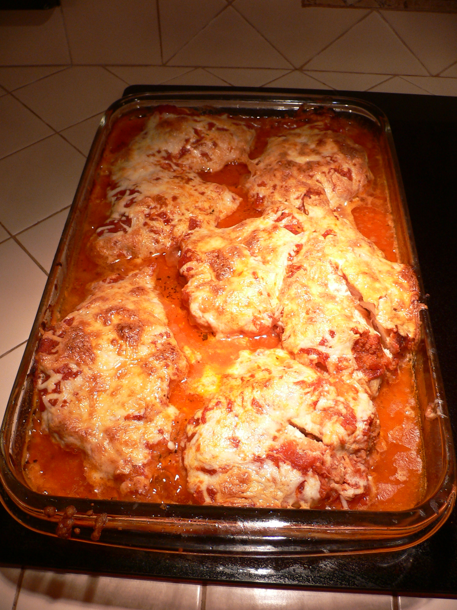

**chicken parm** (/ˌtʃɪkɪn ˈpɑːrm/) is an informal name for **chicken Parmesan**, also [[called]] **chicken parmigiana**: breaded chicken topped with tomato sauce and melted cheese, commonly mozzarella and Parmesan. It is an Italian-American dish, often served with pasta or in a [[sandwich]].

**Parm** is pronounced like “arm” with a **p** at the beginning.

Sources: [Dictionary.com — parm](https://www.dictionary.com/browse/parm); [Chicken parmesan](https://en.wikipedia.org/wiki/Chicken_parmesan).

Chicken Parmesan with tomato sauce and melted cheese. Photo by Raul654, [Wikimedia Commons](https://commons.wikimedia.org/wiki/File:Chicken_parmesan.jpg), [CC BY-SA 2.5](https://creativecommons.org/licenses/by-sa/2.5/).
