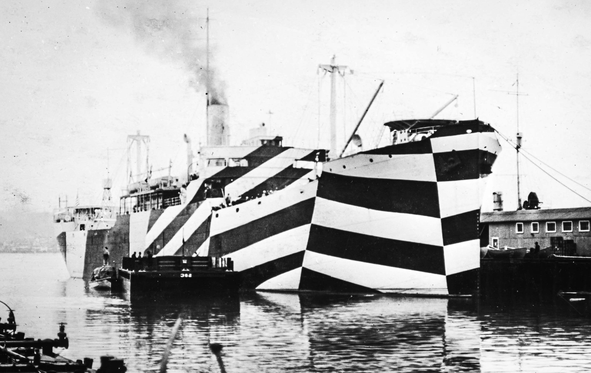

**dazzle camouflage** (/ˈdæzl ˈkæməflɑːʒ/) is a ship-painting scheme using bold, contrasting geometric shapes to make its speed and direction harder for an observer to judge. ([Wikipedia](https://en.wikipedia.org/wiki/Dazzle_camouflage))

USS *West Mahomet*, 1918. Public domain photograph via [Wikimedia Commons](https://commons.wikimedia.org/wiki/File:USS_West_Mahomet_-_19-N-1733_cropped-2.jpg).
