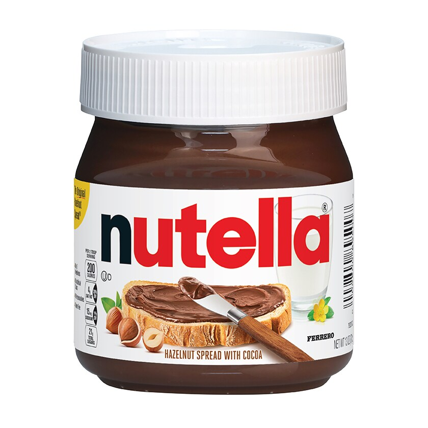

**Nutella** (/nuːˈtɛlə/) is a brand of sweet, creamy hazelnut-and-cocoa spread made by Ferrero. It is commonly spread on toast or used as a topping for pancakes and waffles. ([Nutella — official product information](https://www.nutella.com/us/en/nutellar-jar-nutellar-united-states-official-website); [serving suggestions](https://www.nutella.com/us/en/inside-nutella/faqs))

Pronunciation: /nuːˈtɛlə/ in American English; /nʌˈtɛlə/ is also used in [[british|British]] English. ([pronunciations](https://en.wikipedia.org/wiki/Nutella))

Image: [Nutella — official product photo](https://www.nutella.com/us/sites/nutella_us/files/2020-11/nutella13-oz.jpg), Ferrero.
