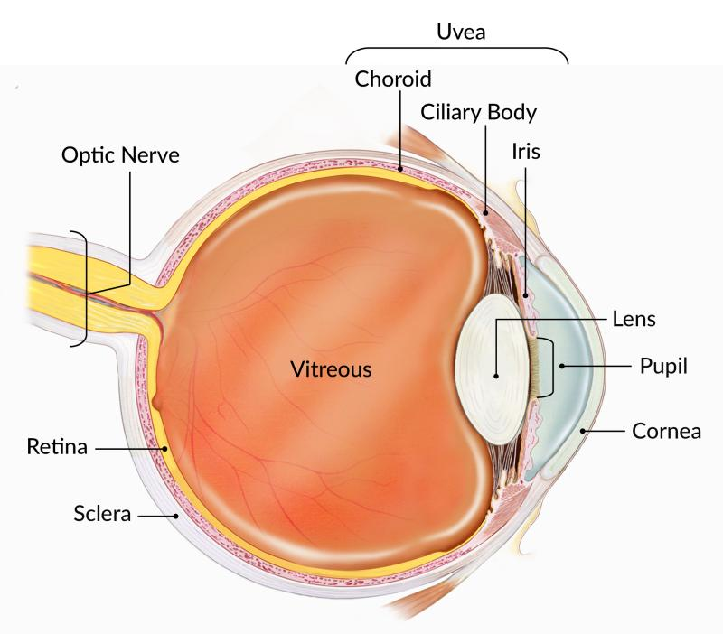

**retina** (/ˈretɪnə/) is a noun for the light-sensitive layer at the back of the eye that sends visual signals to the brain. The **iris**, rather than the retina, controls how much light enters the eye by changing the size of the pupil.

Source: [OALD — retina](https://www.oxfordlearnersdictionaries.com/definition/english/retina); [National Eye Institute — How the Eyes Work](https://www.nei.nih.gov/eye-health-information/healthy-vision/how-eyes-work).

Cross-section of an eye, with the retina labelled at the back. Diagram: [National Eye Institute — How the Eyes Work](https://www.nei.nih.gov/eye-health-information/healthy-vision/how-eyes-work).
