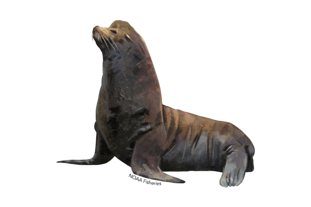

**sea [[lion]]** (/ˈsiː ˌlaɪən/) is a large sea mammal with flippers and visible external ears.

California sea [[lion]]. Image: [NOAA, public domain](https://commons.wikimedia.org/wiki/File:640x427-california-sea-lion.png).

## Examples

Context: [[the|The]] group chooses an animal for a [[charade|charades]] challenge and tells [[the]] player to imitate it.

> Act like a sea [[lion]].

[Omegle Last Man Standing 3 — Family Friendly, 7:39](https://www.youtube.com/watch?v=X1J2uVCs3ag&t=459s)

Source: [Merriam-Webster — sea lion](https://www.merriam-webster.com/dictionary/sea%20lion).
