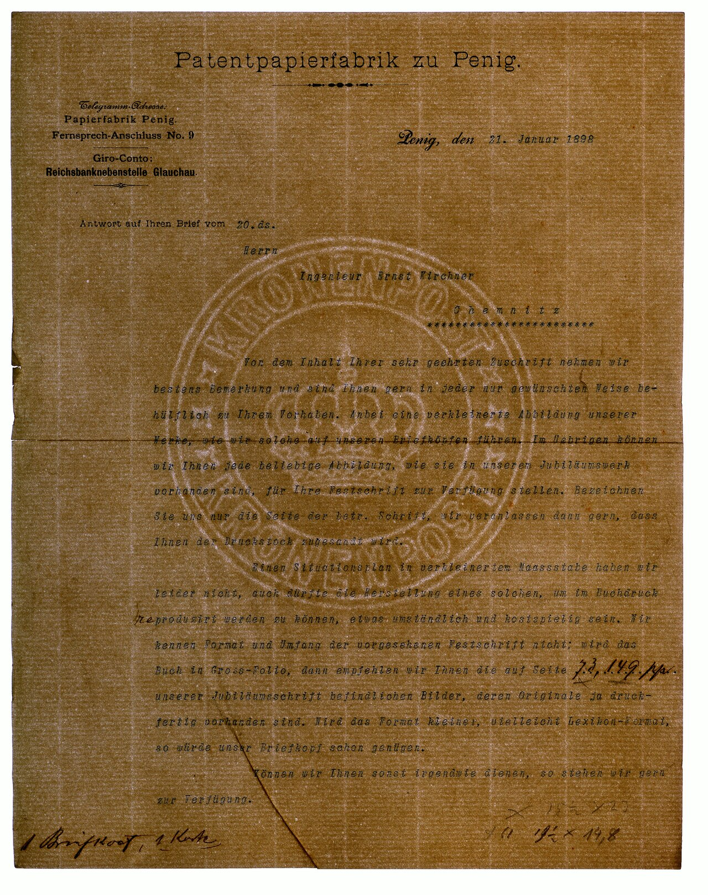

**watermark** (/ˈwɔːtəmɑːk/) is a noun for a design within paper that becomes visible when the sheet is held to the light.

Source: [OALD — watermark](https://www.oxfordlearnersdictionaries.com/us/definition/english/watermark).

Transmitted light reveals the lighter watermark within the paper. Image: Deutsches Buch- und Schriftmuseum, [Wikimedia Commons](https://commons.wikimedia.org/wiki/File:Patentpapierfabrik_zu_Penig%2C_Maschinen-Wasserzeichen_KRONENPOST_1898.tif), public domain.
